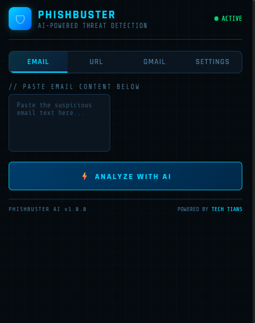
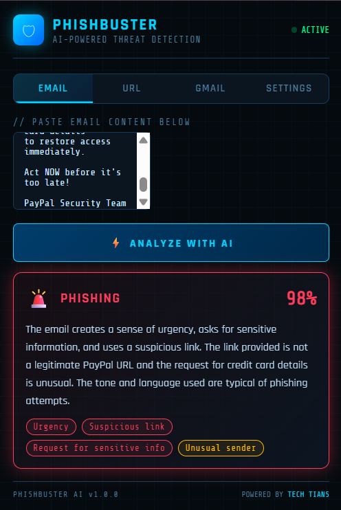
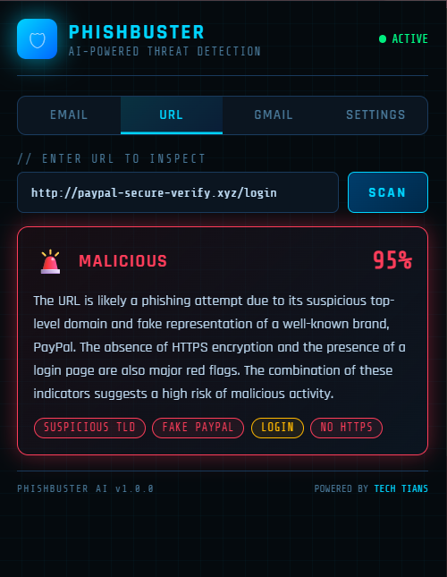
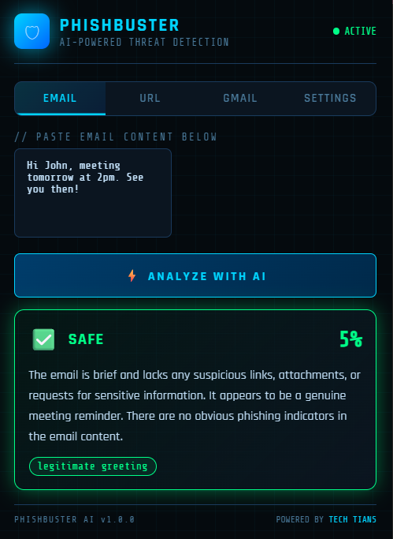

# 🛡️ PhishBuster AI

> AI-powered phishing detection Chrome Extension  
> Built by **TechTitans** 🏆


---

## 🚀 What is PhishBuster AI?

PhishBuster AI is a Chrome Extension that uses **Artificial Intelligence** and **Machine Learning** to detect phishing emails and malicious URLs in real time.

---

## ✨ Features

- 📧 **Email Scanner** — Paste any email and AI analyzes it instantly
- 🔗 **URL Checker** — Detects malicious and suspicious URLs
- 📬 **Gmail Integration** — Scan emails directly inside Gmail
- 🧠 **ML Model** — Trained on 82,000+ real phishing emails (98% accuracy)
- 🤖 **Groq AI** — Deep semantic analysis with detailed explanations
- ⚡ **Heuristic Engine** — Instant local checks with no API needed

---

## 🛠️ Tech Stack

| Technology | Purpose |
|------------|---------|
| HTML, CSS, JavaScript | Chrome Extension UI |
| Chrome Extension API | Browser integration |
| Groq AI (LLaMA 3.3) | AI-powered email analysis |
| Python + Scikit-learn | ML model training |
| Flask | Backend server |
| TF-IDF + Logistic Regression | Phishing classification |
| Google Safe Browsing API | URL threat checking |

---

## 📊 ML Model Performance

- **Dataset:** 82,486 real phishing emails
- **Algorithm:** Logistic Regression + TF-IDF
- **Accuracy:** 98.4%
- **Precision:** 0.98
- **Recall:** 0.98
- **F1 Score:** 0.98

---

## 🔧 Installation

### 1. Clone the repository
```bash
git clone https://github.com/yourusername/PhishBuster-AI.git
```

### 2. Load Chrome Extension
1. Open Chrome → go to `chrome://extensions/`
2. Turn on **Developer Mode**
3. Click **Load unpacked**
4. Select the `PhishBuster-AI` folder

### 3. Set up ML Backend
```bash
cd ml-model
pip install -r requirements.txt
python train.py
python server.py
```

### 4. Add API Keys
- Open extension → Settings tab
- Add your **Groq API key** (get free at console.groq.com)
- Add ML Backend URL: `http://localhost:5000`

---

## 🎯 How It Works
```
User Input (Email/URL)
        ↓
1. Heuristic Engine (instant local checks)
        ↓
2. ML Model (82k trained samples, 98% accuracy)
        ↓
3. Groq AI (deep semantic analysis)
        ↓
Result: SAFE ✅ / SUSPICIOUS ⚠️ / PHISHING 🚨
```

---

## 👥 Team TechTitans

| Name | Role |
|------|------|
| Arnav Tiwari | Lead Developer |
| Kartik Saini | ML and UI/UX Engineer|


---

## 📸 Screenshots






---

## 📜 License

MIT License — free to use and modify!

---

> Built with ❤️ by TechTitans for Haridwar University Tech Sangram 2026